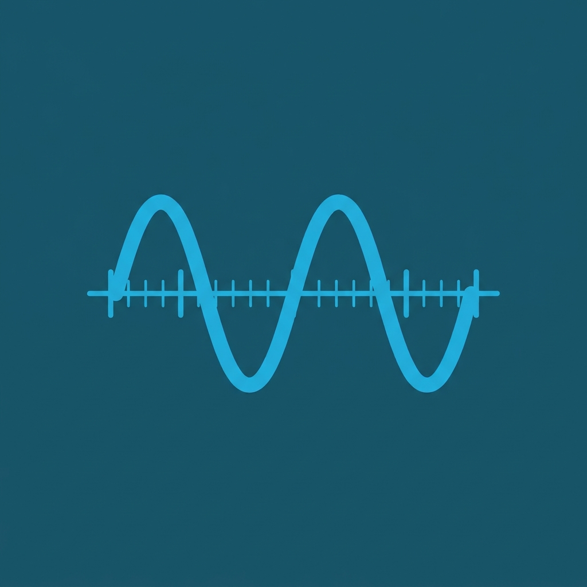
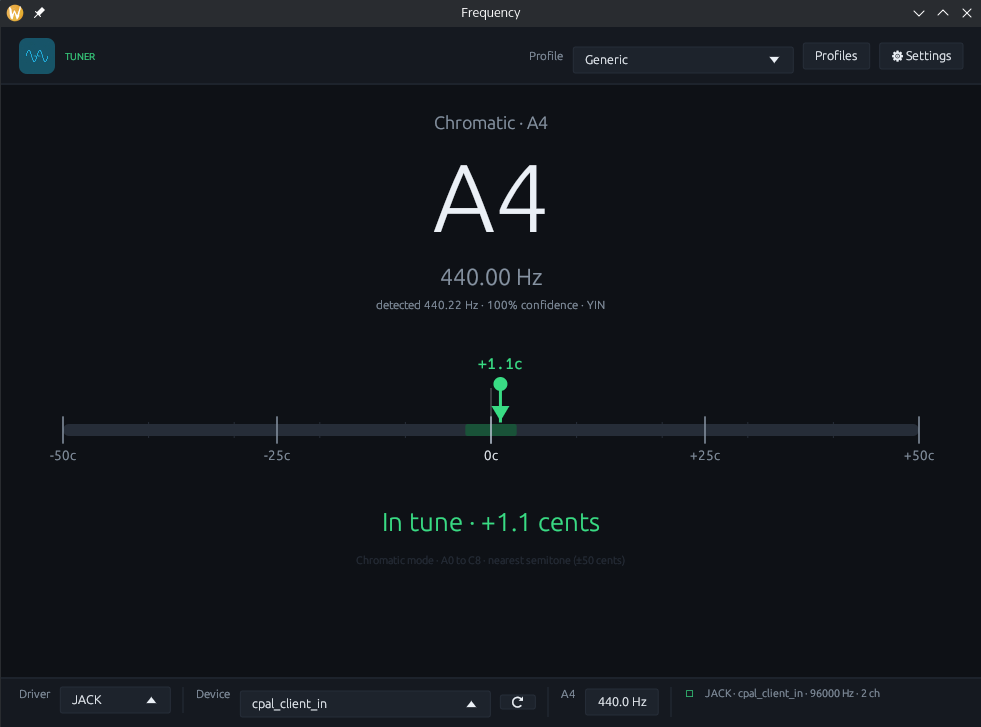

<table>
  <tr>
    <td width="112" valign="middle">
      
    </td>
    <td valign="middle">
      <h1>Frequency</h1>
    </td>
  </tr>
</table>

**Frequency** is a fast, accurate, cross-platform musical instrument tuner written in Rust. It listens through your system's audio input, detects the fundamental pitch in real time, and shows how far you are from the selected target in cents — with low latency and a smooth, GPU-accelerated interface.

- **Chromatic and instrument-specific tuning** — automatic note detection, plus built-in profiles for guitar, bouzouki, mandolin and bass.
- **Custom profiles** — define 1–99 strings or notes using scientific pitch notation or a raw frequency.
- **Real-time feedback** — YIN/MPM pitch detection, adjustable A4 reference, inertia smoothing and a colour-coded cent meter.
- **Flexible audio input** — choose host and device at runtime; on Linux, JACK is used automatically when its server is running, otherwise ALSA/PipeWire.
- **Cross-platform** — Linux, macOS and Windows on x86_64 and aarch64.

## Documentation

- [User Guide](docs/USER_GUIDE.md) — installation, audio setup and day-to-day use.
- [Developer Guide](docs/DEVELOPER.md) — architecture, DSP pipeline, testing and release builds.
- [License](LICENSE) — GNU General Public License v3.0 (GPL-3.0).
